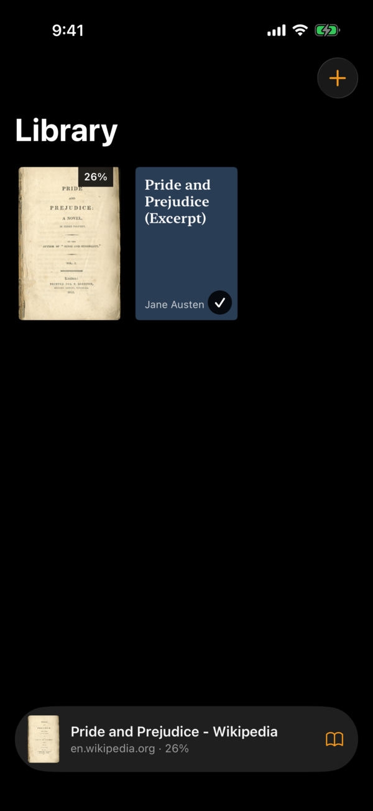
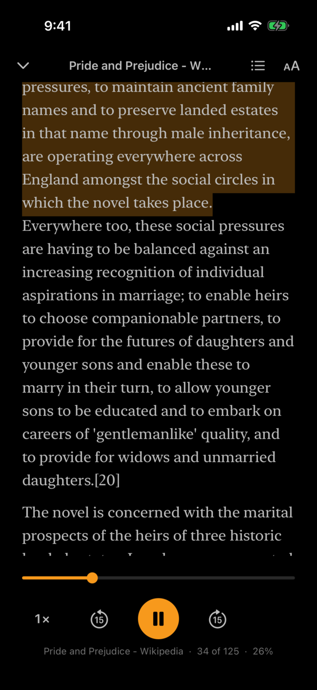
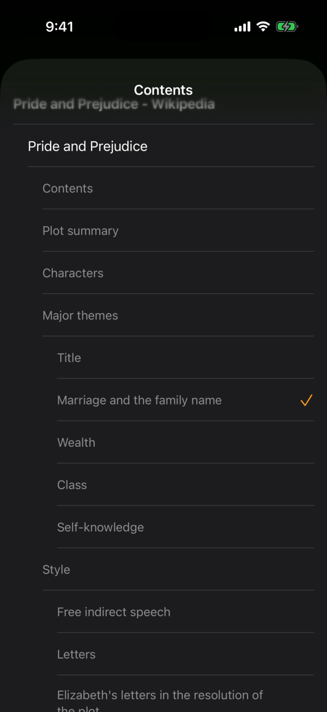
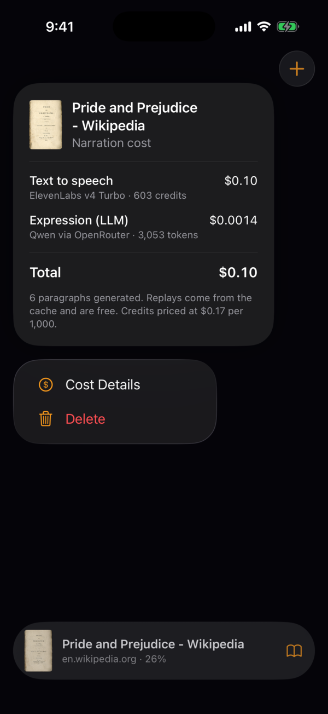

# voice-mode

> [!WARNING]
> **Experimental, personal project.** This app is meant to be built and run from Xcode on your own Mac and your own iPhone (in Developer Mode), or in the iOS Simulator. It hasn't been tested thoroughly, it isn't on the App Store, and it will have bugs. Your API keys are compiled into the app, so **never share or distribute a build**.

An iPhone app that combines a Kindle and an Audible. Every book can be **read** or **listened to**, and your place stays in sync between the two: read a few pages, switch to audio, and the narration starts on the sentence you were reading. Close the audio and the page is where the voice stopped.

Narration is generated on demand with [ElevenLabs](https://elevenlabs.io). An optional LLM pass adds emotional direction (`[sighs]`, `[excitedly]`, …), so it sounds performed rather than read flatly.

<p>
  
  
  
  
</p>

## Features

- **Import** EPUB, PDF, plain-text files, or any web page by URL. Covers come from the EPUB itself, a PDF's first page, or a page's preview image.
- **Reader:** page-by-page (not scrolling) in a serif typeface. Light, dark and **pure black** themes, and adjustable text size.
- **Navigation:** tap the edges or swipe to turn pages. A whole-book scrubber shows a live preview of the section and opening words where you'll land. The contents list includes nested sub-sections.
- **Listening:** narration with the spoken sentence highlighted, and the page follows the voice. Skip ±15 s, set the speed from 0.8× to 2×, and keep listening in the background, with lock-screen and Dynamic Island controls.
- **Sync:** reading and listening share one position, stored as a place in the text rather than a timestamp.
- **Expressive narration:** an LLM (Qwen 3.8 27B via [OpenRouter](https://openrouter.ai)) adds ElevenLabs audio tags to each paragraph. The app checks that no words were changed, so sync can't drift.
- **Per-book cost tracking:** long-press a book to see what its narration has cost, split into text-to-speech and LLM costs. The figures come from the providers' own per-request reports.
- **Caching:** generated audio is cached on the phone, so replaying something you've heard is free.

## How narration works

Text is split into roughly paragraph-sized chunks. When you press play, the chunk at your position is generated, then the next two are prefetched while it plays. Each chunk takes two calls:

1. **OpenRouter** (optional) adds audio tags to the paragraph.
2. **ElevenLabs** `text-to-speech/{voice}/with-timestamps` with `eleven_v4_turbo` returns the audio plus per-character timing. That timing maps every moment of audio back to a position in the text, which drives the highlighting, page-following and syncing.

Nothing is generated at import time, and cached chunks are never regenerated.

## Requirements

- A Mac with **Xcode 26** or later
- **[XcodeGen](https://github.com/yonaskolb/XcodeGen):** `brew install xcodegen`
- An **ElevenLabs API key**
- Optional: an **OpenRouter API key** for the expressive narration pass
- To run on a real iPhone: an Apple ID added to Xcode (a free Personal Team works), with **Developer Mode** enabled on the phone

## Getting started

```sh
git clone https://github.com/sharanry/voice-mode.git
cd voice-mode
cp .env.example .env     # then fill in your keys
xcodegen generate        # creates VoiceMode.xcodeproj
open VoiceMode.xcodeproj
```

Pick a simulator or your iPhone and press Run. In the app, tap **+ → Add Sample Book** to try it without importing anything.

To build and install on a connected iPhone from the command line:

```sh
xcodebuild -scheme VoiceMode -destination 'platform=iOS,id=<device-udid>' \
  -derivedDataPath build -allowProvisioningUpdates DEVELOPMENT_TEAM=<your-team-id> build
xcrun devicectl device install app --device <device-udid> build/Build/Products/Debug-iphoneos/VoiceMode.app
```

With a free Personal Team you'll need to trust the developer once on the phone (**Settings → General → VPN & Device Management**), and the install expires after 7 days.

Run the tests with:

```sh
xcodebuild test -scheme VoiceMode -destination 'platform=iOS Simulator,name=iPhone 17 Pro'
```

## Configuration

Set these in `.env`. A pre-build script turns them into a git-ignored `Generated/Secrets.swift`.

| Variable | Required | Default |
|---|---|---|
| `ELEVENLABS_API_KEY` | yes | |
| `ELEVENLABS_VOICE_ID` | no | `21m00Tcm4TlvDq8ikWAM` (Rachel) |
| `ELEVENLABS_MODEL_ID` | no | `eleven_v4_turbo` |
| `OPENROUTER_API_KEY` | no; without it, narration is untagged | |
| `OPENROUTER_MODEL` | no | `qwen/qwen3.8-27b` |

ElevenLabs reports the credits each request uses but not what you pay for them. The app assumes the Starter plan ($5 / 30,000 credits); change it under **long-press a book → Cost Details**.

## Project layout

```
project.yml                  XcodeGen spec (the .xcodeproj is generated and git-ignored)
scripts/generate-secrets.sh  .env → Generated/Secrets.swift
VoiceMode/
  App/        entry point
  Model/      Document / Chapter / Heading, SwiftData Book
  Library/    cover grid, import, cost card, sample book
  Importers/  EPUB, PDF, plain text, web page → Document
  Reader/     pagination (TextKit 1), themes, scrubber, reader screen
  Player/     narration playback, lock screen / Now Playing, background session
  Sync/       chunking and text ↔ audio position mapping
  TTS/        ElevenLabs, OpenRouter "director", on-disk audio cache
VoiceModeTests/  unit tests (Swift Testing)
```

Built with Swift 6 and SwiftUI for iOS 18+, using SwiftData, AVFoundation, PDFKit, and [ZIPFoundation](https://github.com/weichsel/ZIPFoundation) for EPUB unzipping.

## Known limitations

- Narration needs a connection. Only parts you've already played (plus about two paragraphs ahead) work offline.
- Web-page import is basic, so some site navigation text can end up at the start.
- No share extension or sleep timer yet.
- The API keys live in the app binary. A real release would need a small backend to make the provider calls instead.
